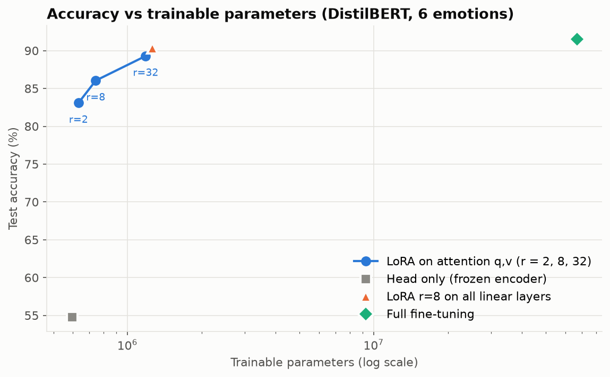
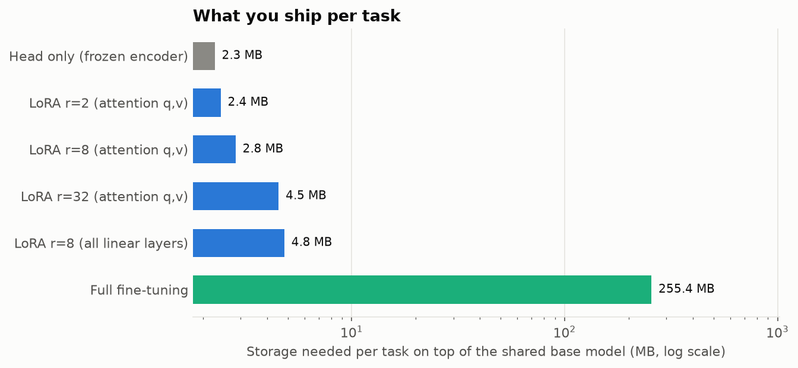

# LoRA & QLoRA: how much accuracy does parameter-efficient fine-tuning cost?


A measured comparison of fine-tuning strategies for DistilBERT on 6-class emotion detection: **head-only**, **LoRA** at different ranks and placements, and **full fine-tuning**. Every run uses the same data, epochs, batch size and sequence length; only what is trainable changes. A second part fine-tunes a **1.1B-parameter LLM with QLoRA** on a free Colab GPU.

👉 **Results notebook with all outputs:** [`notebooks/lora_study_results.ipynb`](notebooks/lora_study_results.ipynb) · **QLoRA notebook:** [`notebooks/qlora_tinyllama_colab.ipynb`](notebooks/qlora_tinyllama_colab.ipynb)

## Results

DistilBERT (`distilbert-base-uncased`, 67M parameters) · 3,999 training texts (stratified sample) · 3 epochs · batch 32 · max 64 tokens · evaluated on the full 2,000-text test set. Trained on a 4-core laptop CPU.

| Method | Trainable params | Trainable % | Test accuracy | Test macro F1 | Gap to full FT | Stored per task | Train time |
|---|---|---|---|---|---|---|---|
| Head only (frozen encoder) | 595K | 0.89% | 54.8% | 0.309 | −36.8 pt | 2.3 MB | 27 min |
| LoRA r=2 (attention q,v) | 632K | 0.95% | 83.1% | 0.767 | −8.4 pt | 2.4 MB | 29 min |
| LoRA r=8 (attention q,v) | 743K | 1.12% | 86.1% | 0.801 | −5.4 pt | 2.8 MB | 27 min |
| LoRA r=32 (attention q,v) | 1.19M | 1.77% | 89.3% | 0.837 | −2.2 pt | 4.5 MB | 27 min |
| **LoRA r=8 (all linear layers)** | 1.26M | 1.88% | **90.3%** | **0.851** | **−1.2 pt** | 4.8 MB | 44 min |
| Full fine-tuning | 66.96M | 100% | 91.5% | 0.870 | — | 255.4 MB | 64 min |



### What the numbers say

- **LoRA gets within 1.2 points of full fine-tuning while training 1.9% of the parameters** (LoRA r=8 on all linear layers), and the adapter is **53× smaller** to store (4.8 MB vs 255 MB).
- **Training only the classifier head is not enough** (54.8%). With the encoder frozen, the model never sees emotions as distinct. It never predicts *love* or *surprise* at all (F1 = 0). Even the smallest LoRA (r=2, just 37K adapter weights) jumps to 83%.
- **Where you put LoRA matters more than its rank.** LoRA r=8 on *all* linear layers (90.3%) beats r=32 on attention only (89.3%) with about the same parameter count. Raising the rank on q,v alone gives diminishing returns.
- **Most "trainable" parameters are the classifier head**, not the adapter. DistilBERT's `pre_classifier` + `classifier` (595K) must be trained in every setup. The LoRA weights themselves are only 37K (r=2), 147K (r=8) and 590K (r=32).
- **LoRA was still improving at epoch 3** (validation accuracy rising every epoch), so with a longer budget the gap to full fine-tuning would likely shrink further.
- **Hardest classes:** *surprise* (F1 0.64–0.74) and *love* (0.64–0.80), the two rarest classes, are where small adapters lose the most.



### Why this matters in practice

One frozen DistilBERT can serve many tasks: swap in a 3–5 MB adapter per task instead of storing a separate 255 MB model for each. The same idea scales to LLMs, where full fine-tuning becomes impossible on a single GPU.

```bash
python -m peft_study.predict "i am terrified of walking home alone at night" "i feel so happy and grateful for my friends today"
```

```
fear      98.8%  i am terrified of walking home alone at night
joy       99.5%  i feel so happy and grateful for my friends today
```

The r=8 adapter isn't perfect: *"i love spending quiet evenings with my partner"* comes out as **sadness** (44.6%), in line with *love* being its weakest class (F1 0.73). See the [results notebook](notebooks/lora_study_results.ipynb) for more examples and per-class F1 for every method.

## Part 2: QLoRA on a 1.1B LLM

[`notebooks/qlora_tinyllama_colab.ipynb`](notebooks/qlora_tinyllama_colab.ipynb) instruction-tunes **TinyLlama-1.1B-Chat** with QLoRA on a free Colab T4. The base model is loaded in 4-bit NF4 (with double quantization), and LoRA adapters (r=16 on q, k, v, o) are trained with a paged 8-bit AdamW optimizer.

| Measured in the Colab run | |
|---|---|
| GPU memory for the 4-bit base model | **1.07 GB** |
| Trainable parameters | 4.5M (0.41% of 1.1B) |
| Training | 1,000 instruction examples, 1 epoch, ~5 min |
| Adapter size | **17.2 MB** |

The notebook compares the model's answer with the adapter disabled and enabled, then merges the adapter into a standalone 16-bit model for deployment. It needs an NVIDIA GPU (`bitsandbytes`), so it isn't part of the CPU study above.

## How it works

| | Head only | LoRA | Full fine-tuning |
|---|---|---|---|
| Encoder weights | Frozen | Frozen; low-rank update `ΔW = B·A` (rank r) added to chosen layers | Trainable |
| Classifier head | Trainable | Trainable (`modules_to_save`) | Trainable |
| Learning rate | 1e-3 | 5e-4 | 5e-5 |
| LoRA α | — | 2r, dropout 0.1 | — |

Each method uses the learning rate that suits it; everything else is identical (AdamW, linear decay with 6% warmup, seed 42).

**A detail that matters:** DistilBERT's `pre_classifier` layer is newly initialised for classification. PEFT only keeps `classifier` trainable by default, which would leave `pre_classifier` frozen at random values. This study adds both to `modules_to_save`.

## Project structure

```
├── peft_study/
│   ├── data.py          # Emotion dataset loading, stratified sampling
│   ├── experiments.py   # The 6 fine-tuning setups
│   ├── train.py         # Training loop, evaluation, adapter saving (resumable)
│   ├── report.py        # Results table and figures
│   └── predict.py       # Inference with a saved adapter
├── adapters/            # Saved LoRA adapters (2.4–4.8 MB each)
├── results/
│   ├── runs/            # One JSON per experiment (metrics, per-class F1, history)
│   ├── results.md, train_log.txt
│   └── figures/
├── notebooks/
│   ├── lora_study_results.ipynb      # Executed results + live predictions
│   └── qlora_tinyllama_colab.ipynb   # QLoRA on TinyLlama (Colab GPU)
├── data/                # Emotions dataset (train / val / test)
└── tests/               # Uses a tiny random DistilBERT: runs in ~1 min
```

## Quickstart

```bash
git clone https://github.com/arslanahmedbhutto/lora-qlora-finetuning.git
cd lora-qlora-finetuning
python -m venv .venv
source .venv/bin/activate              # Windows: .venv\Scripts\activate
pip install torch --index-url https://download.pytorch.org/whl/cpu
pip install -r requirements.txt

python -m peft_study.predict "i was shocked to find out they planned a party for me"
python -m peft_study.train             # all experiments (~3.5 h on a 4-core CPU, minutes on a GPU)
python -m peft_study.train --only lora_r8_qv --train-size 1000   # quick run
python -m peft_study.report
pytest
```

`train.py` saves each finished experiment to `results/runs/` and skips it next time, so a long run can be stopped and resumed.

## Related

- [Emotion-Detection-Transformers](https://github.com/arslanahmedbhutto/Emotion-Detection-Transformers): my published paper fine-tuning DistilBERT, XLNet, RoBERTa and BigBird (fully) on the same dataset, with 92.95–93.20% test accuracy using all 16K training texts and 20 epochs on a GPU.
- [nlp-sentiment-emotion-suite](https://github.com/arslanahmedbhutto/nlp-sentiment-emotion-suite): TF-IDF and BiLSTM baselines on the same dataset (88.2% / 87.6%).

## References

- Hu et al., [*LoRA: Low-Rank Adaptation of Large Language Models*](https://arxiv.org/abs/2106.09685) (2021)
- Dettmers et al., [*QLoRA: Efficient Finetuning of Quantized LLMs*](https://arxiv.org/abs/2305.14314) (2023)
- Dataset: [Emotions dataset for NLP](https://www.kaggle.com/datasets/praveengovi/emotions-dataset-for-nlp)

## Tech stack

Python · PyTorch · Hugging Face Transformers · PEFT · bitsandbytes (QLoRA) · scikit-learn · matplotlib · pytest · GitHub Actions
